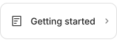
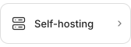
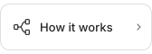
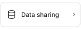
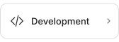

<a href="https://coconet.space/"></a>

# Coconet

<p>
  <a href="https://coconet.space/" title="Open Coconet"></a>
  <a href="README.zh-CN.md" title="切换到简体中文"></a>
</p>

Share Agent sessions and build together. Follow your team's work graph, find
relevant conversations, and pick up where a teammate left off—even in another Agent.

Supports **Codex, Claude Code and Cursor CLI** on macOS and Linux.

## Get started

In the folder you want to connect:

```sh
npm install -g coconet
coconet connect
```

Open the terminal link if your browser doesn't open automatically. Sign in, then
join or create a project. Reopen your Agent and work as usual.

Share the project link with teammates. They can view progress in the browser
or connect their own local folders to collaborate.

## Explore

<p>
  <a href="docs/getting-started.md"></a>
  <a href="docs/README.md"></a>
  <a href="docs/self-hosting.md"></a>
</p>
<p>
  <a href="docs/architecture.md"></a>
  <a href="docs/data-sharing.md"></a>
  <a href="docs/development.md"></a>
</p>

[Contributing](CONTRIBUTING.md) · [Security](SECURITY.md) · [MIT](LICENSE) · [Third-party notices](THIRD_PARTY_NOTICES.md)
