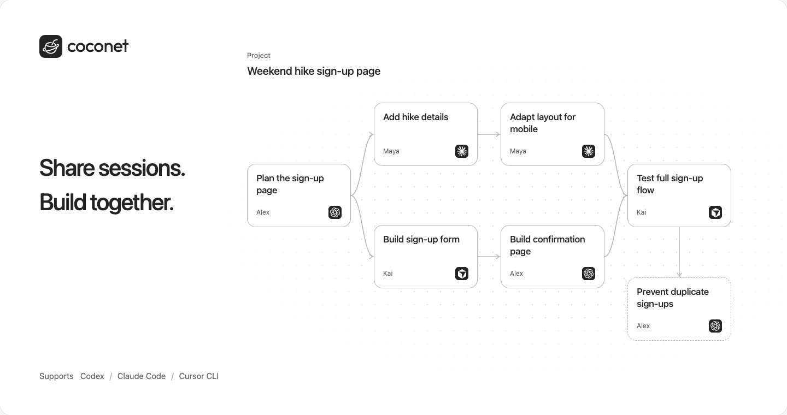
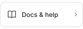
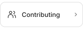
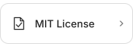

<a href="https://coconet.space/"></a>

#  Coconet

<p>
  <a href="https://coconet.space/" title="Open Coconet"></a>
  <a href="README.zh-CN.md" title="阅读中文"></a>
</p>

Keep up with your team's work without extra status reports. Use your Agent as
usual; Coconet automatically organizes shared progress into a work graph. Find
the conversations behind a decision and, when needed, continue a teammate's session.

Supports **Codex, Claude Code and Cursor CLI** on macOS and Linux.

## Get started

In the folder you want to connect:

```sh
npm install -g coconet
coconet connect
```

Open the terminal link if your browser doesn't open automatically. Sign in, then
join or create a project. Reopen your Agent and work as usual.

Share the project link with teammates. They can view progress in the browser
or connect their own project folders to collaborate.

## Explore

<p>
  <a href="docs/README.md"></a>
  <a href="CONTRIBUTING.md"></a>
  <a href="LICENSE"></a>
</p>
