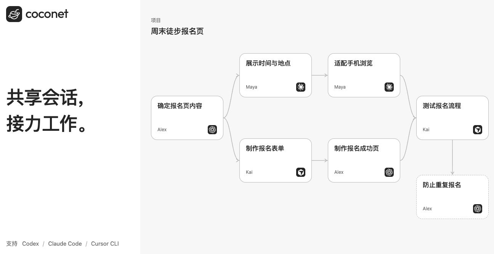
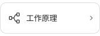

<a href="https://coconet.space/"></a>

# Coconet

<p>
  <a href="https://coconet.space/" title="打开 Coconet"></a>
  <a href="README.md" title="Read in English"></a>
</p>

和同事共享 Agent session，共同推动工作进展。通过工作图了解团队在做什么、找到相关对话，也可以换一个 Agent，接着同事的会话继续工作。

支持 **Codex、Claude Code 和 Cursor CLI**，可在 macOS、Linux 上运行。

## 开始使用

在你希望参与协作的文件夹中执行：

```sh
npm install -g coconet
coconet connect
```

如果浏览器没有自动打开，点击终端中的链接。登录后，选择加入或创建项目，再重新打开 Agent，正常工作即可。

把项目链接发给同事，对方可以直接在网页查看进展，也可以连接自己的本地文件夹，加入协作。

## 进一步了解

<p>
  <a href="docs/getting-started.md"></a>
  <a href="docs/README.md"></a>
  <a href="docs/self-hosting.md"></a>
</p>
<p>
  <a href="docs/architecture.md"></a>
  <a href="docs/data-sharing.md"></a>
  <a href="docs/development.md"></a>
</p>

[贡献指南](CONTRIBUTING.md) · [安全反馈](SECURITY.md) · [MIT 许可证](LICENSE) · [第三方许可](THIRD_PARTY_NOTICES.md)
